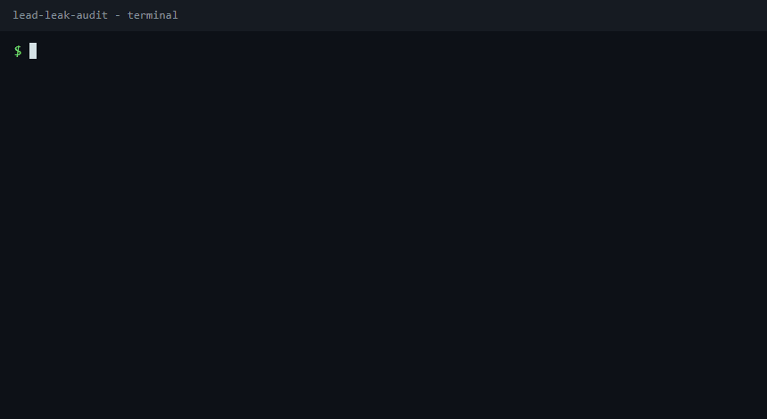
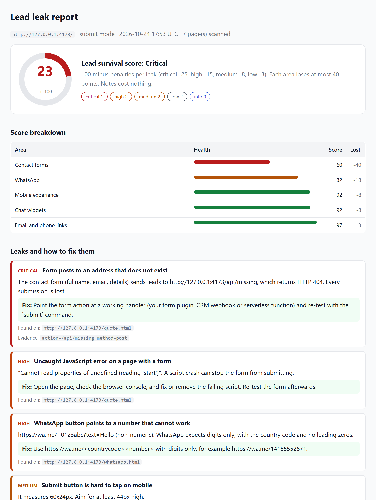

# lead-leak-audit: find where your website's leads die


**You pay for traffic while the contact form returns a 404, the WhatsApp button points to a dead number and the chat bubble never loads.**

A free, local Node CLI that audits your own site's lead path and writes a shareable HTML + JSON report with a 0-100 lead survival score. Nothing is uploaded anywhere.





Open the full [sample report](examples/sample-report.html) (generated from the fixture site in `examples/demo-site`, which is broken on purpose). A [full-page PNG](docs/sample-report-full.png) and a [phone-width PNG](docs/sample-report-mobile.png) are in `docs/`.

Zero install (needs Node 20+ and a one-time `npx playwright install chromium`):

```bash
npx github:waseemnasir2k26/lead-leak-audit scan https://your-site.example
```

## What it will never submit

`scan` is read-only. `submit` is an **allow-list**: a form is submitted only when it shows positive signals of being an enquiry form, and never when any negative signal appears in what a person would read (button text, labels, headings, select options, field names, form attributes, page URL and title).

- **Positive (all three needed, an AND):** (1) contact intent in the heading, button, label or legend near the form (contact, enquire, get a quote, request a callback, send message, book a consultation, get in touch, talk to us, plus Spanish, French, German, Portuguese and Urdu basics) or recognised contact-form markup (Contact Form 7, Gravity Forms, WPForms, Elementor, HubSpot, GoHighLevel and similar); **and** (2) a message / details box (or, for recognised form-builder markup, name + email + phone); **and** (3) an email or phone field to reply to.
- **Negative (any one rejects):** reply, answer, thread, topic, "Re:" headings, comment, review, rating, stars, score, testimonial, guestbook, forum, post, donate, give, pledge, tip, amount, price, quantity, refund, cancel, unsubscribe, erase, delete, GDPR, report listing, password, reset, recover, register, sign up, RSVP, waitlist, webinar, attend, checkout, payment, card, Stripe / PayPal / Braintree / Square elements, job applications, file uploads, login, multi-step forms (a "Next" button, or hidden card fields), currency symbols or amounts in labels, options or placeholders, yes/no or attending radios and selects, and any number or range input of unknown purpose.
- An `amount`, `price` or `quantity` field means the form is never submitted, and the tool never fills a number input it cannot tie to a harmless purpose (phone, zip, year, staff count and similar).
- Newsletter sign-ups (email-only forms) are skipped unless you pass `--include-newsletter`, because that subscribes your test inbox.
- Anything unknown is rejected. If a real contact form is skipped, `--dry-run` says why.
- **Third-party form services** (Formspree, Netlify Forms, Google Forms, Basin, Typeform, Jotform, HubSpot embeds and similar) are skipped by default: a form that posts to another host is "blocked: foreign host", and a cross-origin iframe is listed as an embedded third-party form to test by hand. `--allow-domain <host>` opts a host in; the vendor then receives a real test lead.

This is the literal output of `node scripts/gen-readme-table.mjs --write` (a dry run against look-alike fixtures; those pages are named after the shape, so the URL and title add to some of the reasons). The neutral-name fixtures in `test/neutral-site.js` (`/page1`, title "Welcome") prove the same decisions without that help.

<!-- table:start -->
| Form shape | Verdict | Why (literal dry-run output) |
| --- | --- | --- |
| `cf7` | submitted | accepted: contact-form markup; message field "your-message" |
| `gravity` | submitted | accepted: contact-form markup; message field "input_3" |
| `wpforms` | submitted | accepted: contact-form markup; message field "wpforms[fields][2]" |
| `elementor` | submitted | accepted: contact-form markup; message field "form_fields[message]" |
| `hubspot` | submitted | accepted: contact wording "How can we help"; message field "message" |
| `shopifyContact` | submitted | accepted: contact wording "Contact"; message field "contact[body]" |
| `ghl` | submitted | accepted: contact-form markup; name + email + phone in contact-form markup |
| `booking` | submitted | accepted: contact wording "Request booking"; message field "notes" |
| `hubspotNL` | never | newsletter form: skipped because a test lead would subscribe the test inbox. Pass --include-newsletter to test it. |
| `shopifyNLfooter` | never | newsletter form: skipped because a test lead would subscribe the test inbox. Pass --include-newsletter to test it. |
| `shopifyCart` | never | blocked: forbidden endpoint /cart (cart, checkout, order or payment endpoint) |
| `shopifyAdd` | never | blocked: forbidden endpoint /cart/add (cart, checkout, order or payment endpoint) |
| `shopifyRecover` | never | blocked: forbidden endpoint /account/recover (account, unsubscribe, delete, login, register or password endpoint) |
| `donation` | never | rejected as donation: negative signal "donat" in headings; negative signal "donat" in page; negative signal "donat" in attrs |
| `donation2` | never | rejected as donation: negative signal "donat" in headings; negative signal "donat" in page; negative signal "donat" in attrs |
| `donate3` | never | rejected as donation: negative signal "Donat" in buttons; negative signal "donat" in headings; negative signal "donat" in page |
| `job` | never | rejected as file-upload: file upload field |
| `jobNoFile` | never | rejected as job: negative signal "Apply" in buttons; negative signal "careers" in attrs; negative signal "cover_letter" in fields |
| `bookingCard` | never | rejected as commerce: card fields |
| `bookingCard2` | never | rejected as commerce: payment widget (Stripe, PayPal, Braintree, Square or a card element) inside the form |
| `reset` | never | rejected as account: negative signal "reset" in buttons; negative signal "reset" in headings; negative signal "reset" in page |
| `reset2` | never | rejected as account: negative signal "reset" in headings; negative signal "reset" in page; negative signal "recover" in attrs |
| `gdpr` | never | rejected as account: negative signal "gdpr" in headings; negative signal "gdpr" in page; negative signal "privacy-request" in attrs |
| `gdpr2` | never | rejected as account: negative signal "gdpr" in headings; negative signal "gdpr" in page; negative signal "gdpr" in attrs |
| `forum` | never | rejected as comment: negative signal "forum" in headings; negative signal "forum" in page; negative signal "bbp" in attrs |
| `forum2` | never | rejected as comment: negative signal "reply" in buttons; negative signal "forum" in headings; negative signal "forum" in page |
| `review` | never | rejected as comment: negative signal "review" in buttons; negative signal "review" in headings; negative signal "review" in page |
| `review2` | never | rejected as comment: negative signal "review" in buttons; negative signal "review" in headings; negative signal "review" in page |
| `testimonial` | never | rejected as comment: negative signal "testimonial" in headings; negative signal "testimonial" in page; negative signal "testimonial" in attrs |
| `guestbook` | never | rejected as comment: negative signal "guestbook" in buttons; negative signal "guestbook" in headings; negative signal "guestbook" in page |
| `rsvp` | never | rejected as event: negative signal "RSVP" in buttons; negative signal "rsvp" in headings; negative signal "rsvp" in page |
| `waitlist` | never | rejected as event: negative signal "waitlist" in buttons; negative signal "waitlist" in headings; negative signal "waitlist" in page |
| `webinar` | never | rejected as account: negative signal "Register" in buttons; negative signal "webinar" in buttons; negative signal "webinar" in headings |
| `report` | never | rejected as account: negative signal "Report this listing" in buttons |
| `refund` | never | rejected as commerce: negative signal "refund" in buttons; negative signal "refund" in headings; negative signal "refund" in page |
| `cancel` | never | blocked: forbidden endpoint /sink/cancel (account, unsubscribe, delete, login, register or password endpoint) |
| `postcomment` | never | rejected as comment: negative signal "comment" in buttons; negative signal "Post" in buttons |
| `reviews-page` | never | rejected as comment: negative signal "reviews" in headings; negative signal "reviews" in page |
<!-- table:end -->

Real contact forms from Contact Form 7, Gravity Forms, WPForms, Elementor, HubSpot, GoHighLevel and Shopify are accepted and tested; the suite asserts both lists against a local server.

## What it finds

- **Forms**: fields, action, method, required fields, honeypot fields, reCAPTCHA / hCaptcha / Turnstile. Flags forms that post to a missing address, over plain HTTP, or sit next to a JavaScript crash.
- **Email and phone links**: `mailto:` format, placeholder addresses, whether the domain can receive mail (MX), `tel:` links that are not dialable or not in E.164.
- **WhatsApp links** (`wa.me`, `api.whatsapp.com`): number format, prefilled text, and whether the link loads. It never sends a message.
- **Chat widgets**: Intercom, Crisp, Tawk.to, Tidio, HubSpot, Drift, LiveChat, Zendesk, GoHighLevel / LeadConnector, Facebook Messenger, detected by script signature, then checked for whether the widget actually rendered.
- **Booking links**: Calendly, Cal.com, GoHighLevel, Acuity links that resolve.
- **Mobile signals** (390x844 viewport): contact call-to-action in the first screen, submit button size and overlap, form hidden on phones.
- **With `submit`**: what a real submission does (HTTP result, confirmation shown, redirect, network errors) and, with IMAP, how long the first reply takes.

## 30-second quickstart

```bash
git clone https://github.com/waseemnasir2k26/lead-leak-audit.git
cd lead-leak-audit
npm install
npx playwright install chromium

npm run demo                      # fixture site, report in reports/demo/report.html
node src/cli.js scan https://your-site.example   # read-only audit of a site you own
```

Reports land in `./reports/report.html` and `./reports/report.json` (`--out <dir>` to change).

Test what a real lead does (only on a site you own):

```bash
node src/cli.js submit https://your-site.example --i-own-this-site --email test-inbox@your-site.example --dry-run   # show the plan
node src/cli.js submit https://your-site.example --i-own-this-site --email test-inbox@your-site.example   # shows the plan, asks y/N
```

Measure reply speed too (the inbox must receive your auto-reply):

```bash
export LLA_IMAP_HOST=imap.your-provider.example LLA_IMAP_USER=test-inbox@your-site.example LLA_IMAP_PASS=...
node src/cli.js submit https://your-site.example --i-own-this-site --email test-inbox@your-site.example --imap --wait 15
```

Requires Node 20+. `imapflow` is an optional dependency, only used by `--imap`.

## Safety rails

**Run this only on sites you own or have written permission to test.** `scan` is read-only. `submit` sends real test leads, so it has hard limits that you cannot turn off:

- **A human confirms first.** `submit` prints the plan (per form: page URL, heading, button text, fields, verdict and reason) and asks `y/N` before anything is sent. Without a terminal it refuses. `--yes` skips the prompt for unattended runs but requires `--only <n|#id|.class|text>`, so a scheduled run can never auto-pick forms.
- Refuses to run without `--i-own-this-site` (and without `--email`).
- Only touches the audited host (scheme-less, port-aware) plus hosts you list with `--allow-domain`.
- At most one submission per distinct form per run, at most 10 forms per run. Only forms that pass the allow-list above are eligible.
- If a CAPTCHA is present, the form is marked "blocked by CAPTCHA, test manually". The tool never tries to solve or bypass one.
- Test leads are marked: name `LEAD-LEAK-AUDIT TEST`, a message saying it is an automated test of your own site, and a unique test ID. Honeypot fields stay empty.
- `--dry-run` prints exactly what would be filled and sends nothing.
- WhatsApp is never contacted by design: links are validated and fetched, nothing more.
- IMAP details come from env vars only (never CLI arguments), are never logged, and are redacted from every report. The test inbox address is masked in the report.
- `robots.txt` is honoured for the pages visited and for the paths a submission would reach. Form actions are only probed on the scanned host; WhatsApp and booking links are never fetched at private, loopback or link-local addresses (unless the scanned site itself is on one), and connections go to the address that was checked.

Enforced again at the browser's network layer, whatever the form markup says:

- Every non-GET request, and every navigation after the submit click, is judged by its real URL: host allow-list, `robots.txt`, and a never-touch list (comments, cart, checkout, orders, payments, account, unsubscribe, delete, login, register, password). A button's `formaction`, an action set by script and `fetch()` calls are all covered. A blocked request is aborted and reported as "blocked: forbidden endpoint <path>", and the form counts as not submitted.
- Redirects are followed by the tool, not the browser: each hop is checked against the same rules. A hop that leaves the allowed hosts is aborted. After a POST, a redirect to a foreign host is reported as "unconfirmed: the site redirected to <host>, which the safety rail blocked; check that host's thank-you page manually" (a 3xx only proves the server answered). A redirect to the same host followed by a success page is "accepted". A confirmation page on a foreign host is never reported as accepted.
- Service workers are blocked. Foreign WebSockets and foreign GET beacons or images after the click are blocked and recorded in the report.
- New windows and tabs (`target="_blank"`, `window.open`) are watched, so their result is seen.
- Watchdogs: a whole-run cap (`--max-runtime`, default 10 minutes) and a per-form cap (`--form-timeout`, default 90 s); timeouts are reported.

Exit codes: `0` ok, `1` error, `2` CI check failed, `3` refused by a safety rail.

## Reply timing

With `--imap` the tool polls the test inbox for up to `--wait` minutes (default 15) and matches replies to forms by the unique test ID in the message.

| First reply | Bucket |
| ----------- | ------ |
| under 5 min | great  |
| under 1 h   | ok     |
| over 1 h    | leak   |
| none        | dead   |

Use a test inbox that is different from the address your site notifies, or the notification email will count as the "reply".

## Score

100 minus a penalty per leak: critical 25, high 15, medium 8, low 3, notes 0. Each area (forms, links, WhatsApp, chat, booking, mobile, speed, coverage) loses at most 40 points so one broken area does not hide the rest. 90+ Healthy, 70+ Leaky, 40+ Bleeding, below that Critical. Every leak in the report comes with a plain-English fix.

## Weekly check in n8n

`--ci --threshold 75` exits with code 2 when the score is too low; `--baseline` also fails on a drop versus the last report (a missing baseline is just "no baseline yet"; `--update-baseline` creates and advances it). [examples/n8n-weekly-check.json](examples/n8n-weekly-check.json) wires that to a Monday schedule and an email. Setup: [docs/n8n.md](docs/n8n.md).

## Options

```
lead-leak-audit scan <url>   [--max-pages 15] [--out dir] [--settle ms] [--no-link-check] [--no-mx-check] [--json] [--quiet]
lead-leak-audit submit <url> --i-own-this-site --email <inbox> [--allow-domain host] [--max-forms 10]
                             [--dry-run] [--only n|#id|.class|text] [--yes] [--dwell 6] [--include-newsletter] [--max-runtime 10] [--form-timeout 90] [--imap] [--wait 15]
CI: [--ci] [--threshold 70] [--baseline report.json] [--update-baseline] [--max-drop 10]
Both: [--open]  open report.html when done
```

## Limits

- **CAPTCHAs are never solved.** Those forms are listed for manual testing. A CAPTCHA that silently rejects real visitors cannot be detected.
- **Forms inside third-party iframes** (embedded HubSpot, Typeform, etc.) are not seen or submitted.
- **Single-page apps with custom widgets**: forms built without a `<form>` element and chat widgets with unknown markup can be missed or reported as "not rendered". Treat "installed but never appears" as a prompt to look, not proof.
- **Chat widgets** that appear only after a delay longer than `--settle`, a click, a consent banner or business hours look like failures.
- **WhatsApp**: the tool checks format and that the link loads. It cannot know whether the number is registered on WhatsApp.
- **Form actions** are probed with a harmless HEAD request; some servers answer HEAD differently from POST. Use `submit` for ground truth.
- **Reply timing** matches the test ID in the email text; replies that omit the original message and the ID are not matched. Clock differences between your machine and the mail server can shift results by a few seconds.
- Single-language heuristics for success and error messages (English and a few common words).
- Pages that need a login are out of scope.
- **Delivery is unverified without `--imap`.** A thank-you page proves the form answered, not that the lead reached an inbox, so without `--imap` the best outcome is "accepted" ("Accepted by the site, not verified: run with --imap to confirm delivery"). Only an IMAP reply carrying the test ID produces "delivered". A blank page, a vanished form or a crash page is "unconfirmed".

**Outcome levels** (best to worst; the names are exact):

| Outcome                     | Meaning                                                                                                                                        | Counts as                                        |
| --------------------------- | ---------------------------------------------------------------------------------------------------------------------------------------------- | ------------------------------------------------ |
| `delivered`                 | An IMAP reply carrying the test ID reached the test inbox. The only proof of an inbox.                                                         | OK, no finding                                   |
| `accepted`                  | Positive evidence (success message, thank-you URL, or JSON `ok`/`success` true) and no negative cue in the visible text or JSON. Not verified. | OK, with an "unverified" note (info, no penalty) |
| `accepted-redirect-blocked` | Your server received the lead; a follow-up script or meta-refresh navigation to another host or forbidden endpoint was blocked by the safety rail.                                            | Info                                             |
| `unconfirmed`               | Accepted by HTTP, but no positive evidence; a success word next to a negative cue; or a 3xx redirect to a foreign host that the safety rail blocked.                                                          | High (or medium for a crash page)                |
| `error-message`             | A negative cue with no success wording, or a JSON error (`ok`/`success` false, `status` "error", a filled `error`/`errors`).                   | High                                             |
| `failed`                    | Network failure or HTTP 4xx/5xx on the submission.                                                                                             | Critical                                         |

Negative cues (English, plus basic Spanish, French, German and Portuguese) include "not", "n't", "error", "failed", "unable", "cannot", "problem", "issue", "try again", "went wrong", "rejected", "marked as spam", "invalid" before a field word ("invalid email"), "no se pudo", "error al", "échec", "nicht", "falhou". A bare "spam" or "invalid" is not a cue. Before matching, every visible word, label, button and URL is normalised (fullwidth to ASCII, zero-width and bidi characters removed, Cyrillic and Greek look-alikes folded to Latin). A visible word that mixes Latin with Cyrillic or Greek letters is treated as obfuscated text, and the form is never submitted.

- **Time traps and honeypots.** The tool waits `--dwell` seconds (default 6) after the page loads and types at human pace, because many spam filters drop forms submitted instantly. It never fills a field that is hidden or whose label, placeholder or name says to leave it empty ("leave this blank", "do not fill", "bot", "honeypot"). Filters that judge mouse movement, IP reputation or JavaScript challenges can still reject a test lead, and that shows up as "no confirmation".
- **Redirects after the submission are not followed off-site.** If the server answers the POST with a redirect (3xx) to another host, the result is "unconfirmed": a 3xx only shows the server answered, and the thank-you page on that host is not visited, so check it by hand. If the page navigates (script or meta refresh) to another host or a forbidden endpoint after the lead was received, the result is "accepted-redirect-blocked" (received by your server; the follow-up was blocked by the safety rail).
- **Frames.** Forms inside same-origin iframes are scanned and tested; forms in cross-origin iframes (Typeform, Jotform, HubSpot and similar) are listed as "embedded third-party form" and need a manual test.
- **Multi-step forms** are never submitted; the report says to test them manually.

## Development

```bash
npm test          # node --test: unit tests plus an end-to-end run against a local fixture site
npm run demo:sample   # regenerate examples/sample-report.html
```

Layout: `src/rules.js` (detectors), `src/inventory.js` and `src/findings.js` (what was found, what it means), `src/submit.js` (rails and outcomes), `src/report.js`, `examples/demo-site` (fixture).

## For you if

- You run ads, SEO or outbound and want to know the lead path is working before you spend more.
- You maintain client sites and want a weekly check that tells you when a form or button breaks.
- You can run a command line and own the sites you test.

Not for you if you want to test sites you do not control, or to get past a CAPTCHA.

## Want these leaks fixed?

Built by [SkynetLabs](https://skynetjoe.com). If the report shows leaks you would rather not fix yourself, we fix them: https://skynetjoe.com (info@skynetjoe.com).

License: MIT. See [CHANGELOG.md](CHANGELOG.md).
